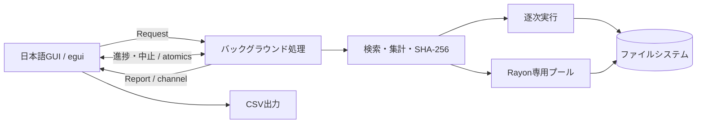

# Fast File Search

**検索・容量確認・ファイル比較を、ひとつのWindowsデスクトップアプリで。**

Rust / eguiで作った日本語GUIツールです。フォルダ内のファイル検索から、サイズ集計、同名ファイルの抽出、SHA-256比較までをまとめています。並列処理とシングルスレッド処理を切り替え、同じ条件で結果と所要時間を確認できます。

A Windows desktop utility for recursive file search, size analysis, duplicate-name detection, and SHA-256 comparison. Built with Rust, egui, and Rayon; Japanese UI.

## できること

| 機能 | 対象 | 内容 |
| --- | --- | --- |
| ファイル名検索 | 複数フォルダ | 部分一致・大文字小文字の区別・空欄で全件 |
| サイズ集計 | 単一フォルダ | ファイル別サイズと合計、サイズ降順表示 |
| 拡張子検索 | 複数フォルダ | `pdf, .txt, *.jpg` のような複数指定 |
| 重複ファイル名検索 | 複数フォルダ | 拡張子を含む同名ファイルをグループ化 |
| SHA-256比較 | 複数ファイル | 各ハッシュ値と全ファイルの一致判定 |

全フォルダ機能がサブフォルダを探索します。進捗表示・中止、結果の並び替え、パス／ハッシュのコピー、UTF-8 BOM付きCSV出力に対応しています。

## 使ってみる

対象: **Windows x86_64**。配布・CIの対象はWindowsです。macOS/Linux向けの配布とGUI検証は行っていません。

1. このリポジトリの **Releases** から `Fast_File_Search-vX.Y.Z-windows-x86_64.zip` を取得します。初回公開前は配布ファイルがありません。
2. ZIPを展開して `Fast_File_Search.exe` を起動します。利用時にRustのインストールは不要です。
3. 左側で機能と処理方式を選び、対象と条件を指定して「実行」を押します。

ZIPには実行ファイル、利用ガイド、MITライセンス、依存ライブラリと内蔵フォントのライセンス一覧を含めます。日本語表示にはWindowsのメイリオ／游ゴシックを読み込みます。Windowsフォント自体は再配布しません。

詳細: [操作ガイドと仕様](docs/USAGE.md) · [変更履歴](CHANGELOG.md)

## このプロジェクトで取り組んだこと

- **応答性を保つGUI**: 検索をワーカースレッドに分離し、チャネルで結果を返します。進捗と中止要求はアトミック変数で共有します。
- **処理方式の比較**: Rayonの専用プールと逐次実行で同じ処理を共有し、両者の結果が一致することをテストします。
- **ファイルシステム上の例外への対応**: 親子フォルダの二重指定、読込エラー、循環するジャンクション、中止時の部分結果を扱います。
- **大きなデータへの配慮**: ハッシュ計算を1 MiB単位のストリーミングで行い、結果一覧は画面に見える行のみ描画します。
- **継続的な検証と配布**: 最低RustバージョンとstableのWindows CI、バージョン付きZIP、SHA-256チェックサム、タグからのRelease下書き作成を用意しています。

並列化の効果はストレージとフォルダ構成に依存します。性能の倍率は未計測のため主張していません。設計判断や制限は[設計ドキュメント](docs/ARCHITECTURE.md)にまとめています。

## 構成



| ファイル | 役割 |
| --- | --- |
| `src/app.rs` | GUI、処理スレッド、進捗と結果の表示 |
| `src/engine.rs` | 入力検証、探索、重複名グループ化、ハッシュ計算 |
| `src/export.rs` | CSVエスケープと表計算ソフト向けの数式対策 |
| `tests/engine.rs` | 実ファイルを使う統合テスト |
| `scripts/package.ps1` | 検証、Windows配布ビルド、ライセンス一覧、ZIP生成 |
| `.github/workflows/` | CIとRelease下書き作成 |

## ソースから実行する

Rust **1.92以上**、Visual Studio Build Toolsの「C++によるデスクトップ開発」（MSVCとWindows SDK）が必要です。初回ビルドには依存ライブラリの取得が必要です。

```powershell
cargo run --locked --bin Fast_File_Search
```

実行対象名は **`Fast_File_Search`** です。IDEのCargo実行設定もこの名前に合わせてください。

```powershell
cargo fmt --all --check
cargo clippy --all-targets --locked -- -D warnings
cargo test --all-targets --locked
cargo build --release --locked --bin Fast_File_Search
```

主なテスト: 並列／逐次の結果一致、日本語ファイル名、親子ルートの重複除外、拡張子、重複名、既知のSHA-256値、複数ブロックの読込、実行中の中止、入力エラー、空フォルダ、ジャンクションの循環回避、CSV。

配布ZIPの生成とGitHubでの公開手順は[リリースガイド](docs/RELEASING.md)を参照してください。CIの実行結果はGitHubのActionsタブで確認できます。

## 仕様上の制限

- 重複名検索は**名前の一致**を調べます。内容の一致確認にはSHA-256比較を使います。
- サイズは論理サイズです。ディスク上の占有量や重複排除後の容量ではありません。
- 配下のリンク・ジャンクション・再解析ポイントは探索しません。クラウドプレースホルダーも対象外になる場合があります。
- 中止は協調的に処理します。OSの入出力待ちは強制中断しません。
- 結果と探索待ちフォルダはメモリに保持します。インデックスの永続化、正規表現検索には対応していません。
- スナップショットは取得しません。比較中は対象ファイルの編集を止めてください。

## 開発への参加・ライセンス

不具合報告と提案はIssuesへ。開発手順は[CONTRIBUTING.md](CONTRIBUTING.md)に記載しています。

本プロジェクトは[MIT License](LICENSE)で公開します。依存ライブラリと内蔵フォントにはそれぞれのライセンスが適用され、配布ZIPの `THIRD_PARTY_LICENSES.html` で確認できます。
